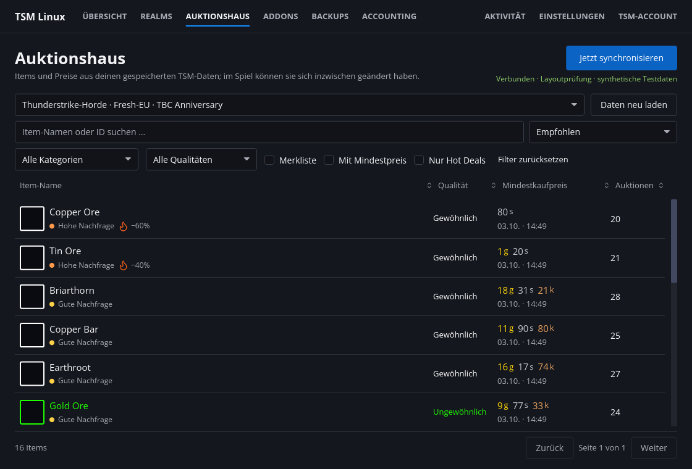
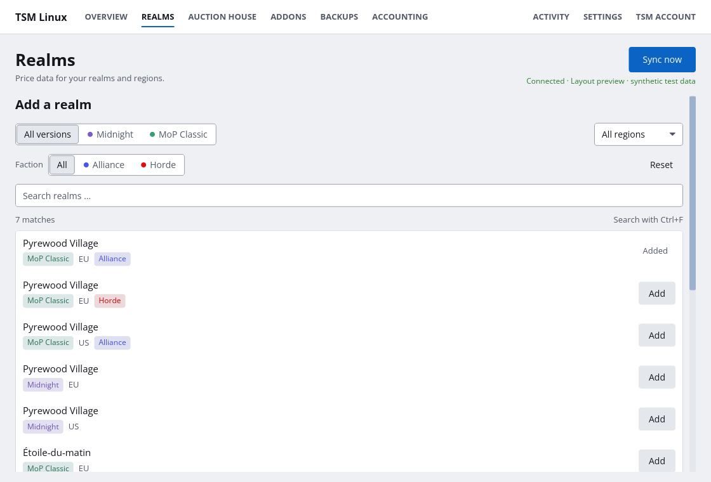
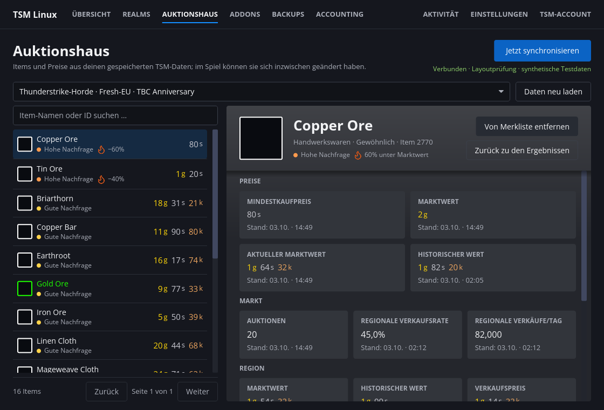
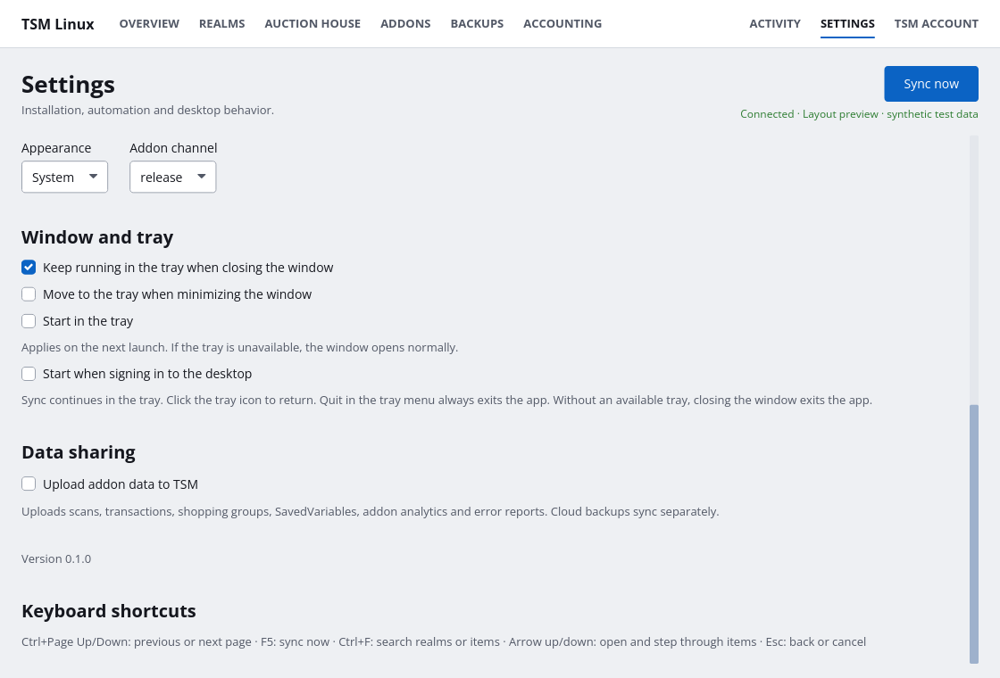

<div align="center">


# Tradewind

**A native Linux client for TradeSkillMaster (TSM).**<br>
Price sync, addon updates, backups, accounting exports and an offline auction house browser for World of Warcraft. No Wine, no Electron.

[](https://github.com/marcomaiermm/tradewind/actions/workflows/ci.yml)
[](https://github.com/marcomaiermm/tradewind/releases/latest)
[](https://github.com/marcomaiermm/tradewind/releases)
<br>
[](https://www.rust-lang.org)
[](https://iced.rs)
[](#installation)
[](#license)

[Installation](#installation) · [Features](#features) · [Screenshots](#screenshots) · [Usage](#usage) · [Building](#building-from-source) · [Docs](#documentation)



</div>

> [!IMPORTANT]
> Tradewind is an **unofficial**, community-built client. It is not affiliated with, endorsed by or supported by TradeSkillMaster or Blizzard Entertainment. Please don't contact TSM support about issues with this app, [open an issue](https://github.com/marcomaiermm/tradewind/issues) here instead.

## Why?

The official TradeSkillMaster desktop application only ships for Windows and macOS. On Linux you either run it through Wine or go without fresh price data. Tradewind is a native Rust reimplementation of the same workflow with the same on-disk formats, so the in-game **TradeSkillMaster** addon can't tell the difference.

## Features

| | |
|---|---|
| 🔄 **Price data sync** | Keeps `TradeSkillMaster_AppHelper` AppData up to date for every realm you follow, every 10 minutes in the background. |
| 🌍 **Realm management** | Search, filter by game version, region and faction, and add realms in one click. |
| 🏛️ **Auction house browser** | Search, filter and sort your synced AuctionDB snapshot offline, with real item icons read from your local WoW install, demand indicators, hot-deal detection and a watchlist. |
| 📦 **Addon updates** | Installs and updates the TSM addons from your selected channel. Updates are staged, validated and rolled back on failure. |
| 💾 **Backups** | Scheduled local SavedVariables backups (no login required), cloud backups for Premium accounts, safe restore with a safety backup. |
| 📊 **Accounting** | Export sales, purchases, income, expenses, expired and cancelled auctions as CSV. |
| 🖥️ **Native desktop citizen** | Wayland and X11, system tray (StatusNotifierItem), autostart, notifications, light/dark theme, keyboard shortcuts. |
| 🌐 **English & German** | Switch instantly, no restart. Numbers and dates follow the language. |
| 🎮 **All game versions** | Retail (Midnight), MoP Classic (Progression), Classic Era and TBC Anniversary. WoW: Forever is detected and ready for when TSM supports it. |

**Safe by design:** passwords are never stored (optional refresh token goes to your Secret Service keyring), every file write is atomic, archives are validated before anything is touched, Lua is parsed but never executed, and data sharing with TSM is **off by default**.

## Screenshots

| Realms | Item details |
|---|---|
|  |  |
| **Settings** | **Auction house** |
|  |  |

<sub>Screenshots are rendered offscreen from the real Iced renderer using synthetic test data.</sub>

## Installation

Pre-built packages for x86_64 are attached to every [release](https://github.com/marcomaiermm/tradewind/releases/latest).

<details>
<summary><b>Arch Linux / Manjaro / EndeavourOS</b></summary>

Tradewind has its own signed pacman repository. Trust its signing key once:

```bash
curl -O https://raw.githubusercontent.com/marcomaiermm/tradewind/main/packaging/arch/tradewind.asc
sudo pacman-key --add tradewind.asc
sudo pacman-key --lsign-key 6A4F7C1A0DD77827FB663CBBF8A74A1AE16AF11C
```

Add the repository to the end of `/etc/pacman.conf`:

```ini
[tradewind]
Server = https://github.com/marcomaiermm/tradewind/releases/latest/download
```

Then install it. Updates come with every `pacman -Syu`.

```bash
sudo pacman -Syu tradewind
```

</details>

<details>
<summary><b>Debian / Ubuntu / Linux Mint / Pop!_OS</b></summary>

```bash
sudo apt install ./tradewind_*_amd64.deb
```

</details>

<details>
<summary><b>Fedora / openSUSE / RHEL-compatible</b></summary>

```bash
sudo dnf install ./tradewind-*.x86_64.rpm      # Fedora
sudo zypper install ./tradewind-*.x86_64.rpm   # openSUSE
```

</details>

<details>
<summary><b>Any distribution (AppImage)</b></summary>

```bash
chmod +x tradewind-*-x86_64.AppImage
./tradewind-*-x86_64.AppImage
```

Install `bsdtar` (libarchive) and `zip` from your distribution for backups and addon updates.

</details>

<details>
<summary><b>Tarball</b></summary>

```bash
tar -xzf tradewind-*-x86_64-linux.tar.gz
./usr/bin/tradewind
```

The app runs straight from the extracted folder, no installation needed.

</details>

Every release includes a `SHA256SUMS` file. Packages target glibc 2.35+ (Ubuntu 22.04, Debian 12, Fedora 36 and newer).

### Runtime dependencies

| Program | Used for | Required |
|---|---|---|
| `bsdtar` (libarchive) and `zip` | Backups, restores, addon archives (including legacy ZIP-LZMA) | yes |
| `xdg-desktop-portal` with a desktop backend, or `kdialog` | Folder picker and CSV save dialogs (portal first, kdialog as fallback) | recommended |
| `secret-tool` (libsecret) | Remembering your sign-in in the keyring | optional |
| `notify-send`, `xdg-open` | Notifications and links | optional |

On Hyprland and other wlroots compositors, your bar needs a StatusNotifierItem tray module for tray support.

## Usage

1. **Settings:** pick or auto-detect your *World of Warcraft* folder and save.
2. **TSM account:** sign in with your TSM e-mail and password. Enable *Remember sign-in* to store a refresh token in your keyring.
3. **Realms:** add the realms you play on. Classic and Anniversary realms are picked up from your local addon data.
4. Press **Sync now** (or <kbd>F5</kbd>). From now on, sync runs every 10 minutes, also from the tray.

> [!WARNING]
> TSM's API server currently presents an invalid TLS certificate, so the session exchange only works with **Use legacy HTTP** enabled at sign-in. In that mode your session token, synced data and cloud backups travel **unencrypted**, exactly like with the official client. Your password and refresh token always use verified HTTPS. Details in [docs/protocol.md](docs/protocol.md#transport).

### Window and tray

| Setting | Default |
|---|---|
| Keep running in the tray when closing the window | on |
| Move to the tray when minimizing | off (X11/XWayland only, Wayland doesn't report minimize) |
| Start in the tray | off |
| Start when signing in to the desktop | off |

**Quit** in the tray menu always exits after finishing any running sync or backup. If no tray is available, closing the window exits the app.

### Keyboard shortcuts

| Key | Action |
|---|---|
| <kbd>F5</kbd> | Sync now |
| <kbd>Ctrl</kbd>+<kbd>F</kbd> | Search realms or items |
| <kbd>Enter</kbd> | Add the single matching realm |
| <kbd>Ctrl</kbd>+<kbd>PgUp</kbd> / <kbd>PgDn</kbd> | Previous / next page |
| <kbd>↑</kbd> / <kbd>↓</kbd> | Open and step through items |
| <kbd>Ctrl</kbd>+<kbd>S</kbd> | Save settings |
| <kbd>Esc</kbd> | Back or cancel |

### Command line

```bash
tradewind                                   # start the app
tradewind --version                         # print the version
tradewind --inspect "/path/to/World of Warcraft"   # read-only installation check
```

### Files

| What | Where |
|---|---|
| Settings | `$XDG_CONFIG_HOME/tradewind/settings.json` |
| Backups, activity log | `$XDG_DATA_HOME/tradewind/` |
| Item icon cache | `$XDG_CACHE_HOME/tradewind/` |
| Refresh token (optional) | Secret Service keyring |

Restore and addon installation require WoW to be closed. Tradewind never imports credentials or settings from the Windows client.

## Project status

Tradewind is **beta**. Local workflows and all reconstructed data formats are covered by tests. Sign-in (legacy HTTP), realm and status queries and price data sync are confirmed against the live service.

- [x] Sign-in, realm management, price data sync
- [x] Auction house browser, local backups, accounting exports
- [ ] Token refresh, remaining sync data types and Premium cloud backups (implemented, need live verification)
- [ ] Built-in update notifications

Found something that doesn't work? [Open an issue](https://github.com/marcomaiermm/tradewind/issues/new/choose).

## Building from source

Requirements: Rust 1.92+, OpenSSL development files and `pkg-config`.

```bash
git clone https://github.com/marcomaiermm/tradewind.git
cd tradewind
cargo build --release --locked
./target/release/tradewind
```

Optionally install binary, menu entry and icons into `~/.local` (or any absolute prefix):

```bash
./tools/install.sh
```

A small, documented fix for Iced's software renderer is vendored in [`vendor/iced_tiny_skia`](vendor/iced_tiny_skia/README.md) and built automatically.

### Development

```bash
cargo test --locked
cargo clippy --locked --all-targets -- -D warnings
cargo fmt --check
```

UI tests render real frames offscreen, so no desktop session is needed. See [CONTRIBUTING.md](CONTRIBUTING.md) for the workflow and release process.

## Documentation

- [Architecture](docs/architecture.md): modules, coordinator, file safety, i18n
- [Auction house browser](docs/auction-house.md): data sources, demand heuristic, formats
- [TSM protocol notes](docs/protocol.md): API, Lua and backup formats
- [Test fixtures](tests/fixtures/README.md)

## Contributing

Contributions are welcome! Please read [CONTRIBUTING.md](CONTRIBUTING.md) first. Commit messages follow [Conventional Commits](https://www.conventionalcommits.org), which drive versioning and the changelog.

## License

Licensed under either of [Apache License 2.0](LICENSE-APACHE) or [MIT License](LICENSE-MIT) at your option.

Unless you explicitly state otherwise, any contribution intentionally submitted for inclusion in this project shall be dual licensed as above, without any additional terms or conditions.

Third-party assets: [Lucide](https://lucide.dev) icons (ISC, see [`data/icons/LICENSE.lucide`](data/icons/LICENSE.lucide)), [Open Sans](https://github.com/googlefonts/opensans) (OFL-1.1, see [`data/fonts/OFL.txt`](data/fonts/OFL.txt)) and the vendored `iced_tiny_skia` (MIT). World of Warcraft is a trademark of Blizzard Entertainment, Inc.

## Acknowledgements

- [TradeSkillMaster](https://tradeskillmaster.com) for the addon and the service this app talks to
- [Iced](https://iced.rs): the GUI toolkit
- [cascette-rs](https://github.com/Osso/cascette-rs): CASC storage access for local item icons
- [texpresso](https://github.com/jansol/texpresso): BCn texture decoding
- [Lucide](https://lucide.dev): icons
